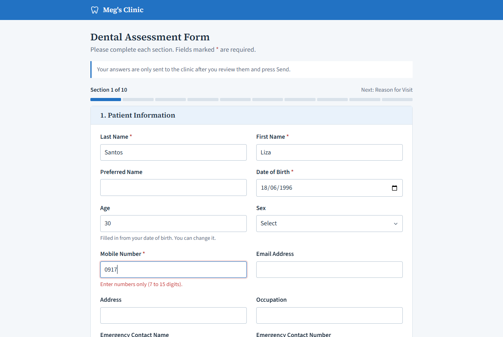
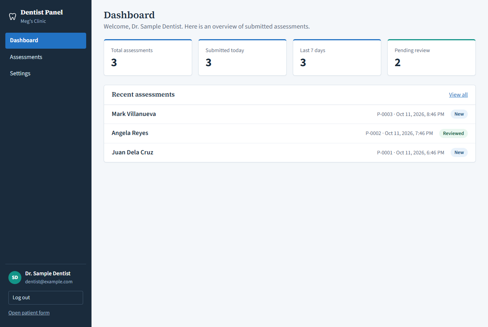
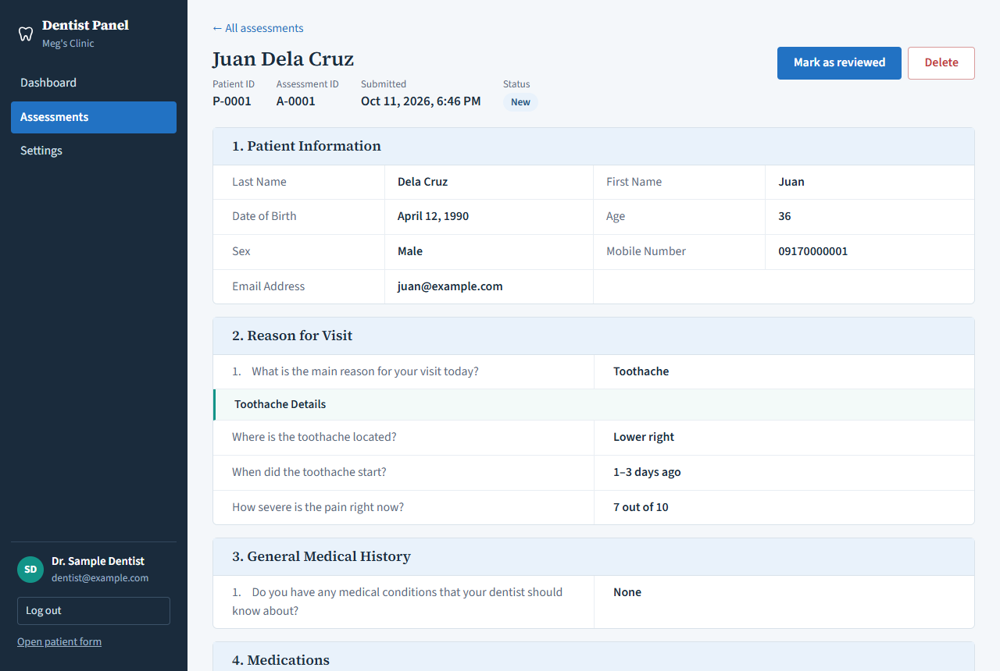
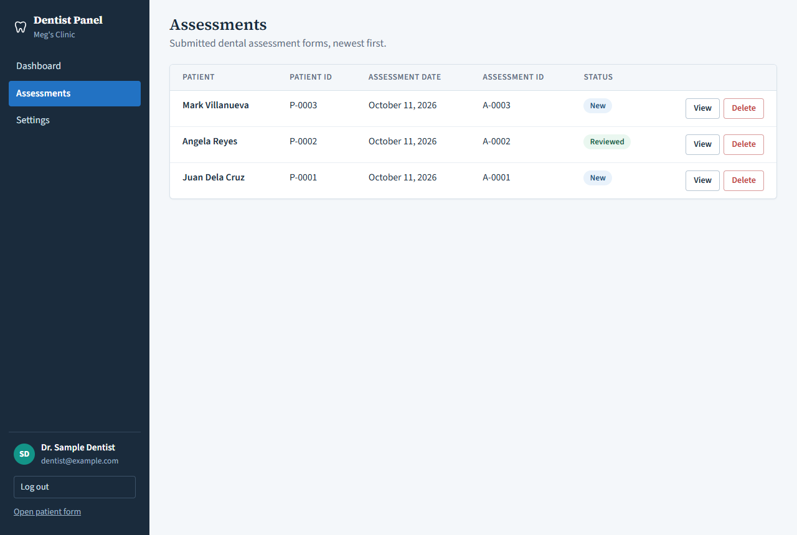
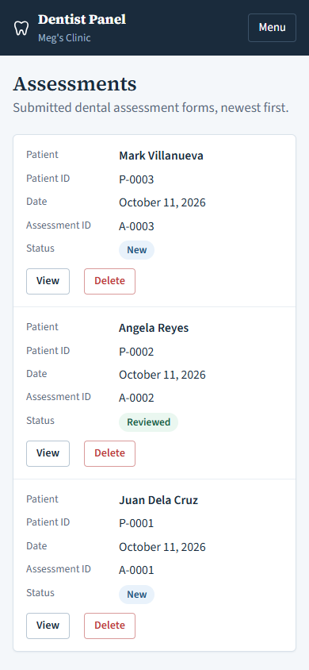

# Dental Assessment Form

A full-stack health check questionnaire for a dental clinic. Patients fill in a multi-step form before their visit; the answers are validated, saved in MySQL, and reviewed by the clinic in a password-protected Dentist Panel.

- **Patient form** (`/`): 10 sections with follow-up questions that appear only when relevant (e.g. toothache details), a review screen, and a confirmation after sending.
- **Dentist Panel** (`/dentist`): log in, see a dashboard and the list of submitted assessments, open one, mark it reviewed, delete it, and edit the clinic settings shown on the patient form.

## Contents

1. [Tech stack](#tech-stack)
2. [Setting up on a new computer](#setting-up-on-a-new-computer)
3. [Adding a staff account](#adding-a-staff-account)
4. [Everyday use](#everyday-use)
5. [Troubleshooting](#troubleshooting)
6. [API endpoints](#api-endpoints)
7. [Testing the API with Thunder Client](#testing-the-api-with-thunder-client)
8. [Screenshots](#screenshots)
9. [Project structure](#project-structure)
10. [Bonus features](#bonus-features)
11. [Known issues](#known-issues)
12. [Use of AI tools](#use-of-ai-tools)

## Tech stack

| Part | Tools |
| --- | --- |
| Frontend (`client/`) | React 19, TypeScript, Vite, Axios |
| Backend (`server/`) | Node.js, Express 5, mysql2/promise, bcryptjs, jsonwebtoken, dotenv, cors |
| Database | MySQL / MariaDB (tested with XAMPP's MariaDB 10.4) |

## Setting up on a new computer

Setup takes about 10 minutes, and most of it is downloading. Run all commands in VS Code's terminal (**Terminal → New Terminal**) from the main project folder, the one that contains `client`, `server` and this README.

### 1. Install the tools

| Tool | Download |
| --- | --- |
| **Node.js 22 LTS** | https://nodejs.org (choose "LTS") |
| **XAMPP** (for MySQL) | https://www.apachefriends.org |
| **Git** | https://git-scm.com |
| **VS Code** | https://code.visualstudio.com |

Restart VS Code after installing, then check that `node -v` prints `v22` (or `v20.19` or newer).

### 2. Download the project

```powershell
git clone https://github.com/Kwacklet/dental-clinic-form.git
cd dental-clinic-form
code .
```

(No Git? On GitHub, click **Code → Download ZIP**, extract it, and open the folder in VS Code.)

### 3. Start MySQL

Open the **XAMPP Control Panel** and click **Start** next to **MySQL**. It turns green.

### 4. Run the setup

```powershell
npm run setup
```

This one command:

1. installs the server and client packages,
2. creates `server/.env` (with a new random login secret) and `client/.env`,
3. creates the `dental_clinic_db` database with two Dentist Panel accounts and three fictional sample assessments.

It ends with `Setup complete`. It is safe to run again: it never overwrites an existing `.env` file or database.

### 5. Set a Dentist Panel password

The database comes with two accounts, both without a password:

| Email | Name | Role |
| --- | --- | --- |
| `meg@megsclinic.com` | Meg Santos | dentist |
| `staff@megsclinic.com` | Maria Cruz | staff |

Set a password for the one you will use (the dentist account is used in the rest of this guide):

```powershell
npm run set-password -- meg@megsclinic.com
```

Type a password (at least 8 characters; nothing shows while you type), press Enter, type it again, press Enter.

### 6. Start the app

```powershell
npm run dev
```

This starts both the server and the app in one terminal. Wait for `Connected to MySQL database` and `Local: http://localhost:5173/`, then open:

- **Patient form:** http://localhost:5173
- **Dentist Panel:** http://localhost:5173/dentist (log in with `meg@megsclinic.com` and your password)

Press `Ctrl+C` to stop.

### Check that it works

1. The patient form shows "Dental Assessment Form" and "Section 1 of 10".
2. Clicking **Next** with empty fields shows red error messages.
3. Fill in the required fields, go through the sections, tick the consent boxes, then **Review answers** → **Send to clinic**: a green "Thank you" appears.
4. In the Dentist Panel, the new assessment is on the dashboard. Open it, **Mark as reviewed**, then **Delete** it.
5. Stop the app (`Ctrl+C`), run `npm run dev` again, and refresh: the data is still there.

### Optional settings

`npm run setup` uses MySQL's default XAMPP login (user `root`, no password). If your MySQL is different, edit `server/.env` and run `npm run setup` again.

| Variable in `server/.env` | Meaning |
| --- | --- |
| `PORT` | Port the API runs on (default 3000). If you change it, change `VITE_API_URL` in `client/.env` too |
| `CORS_ORIGIN` | Address of the app allowed to call the API (default http://localhost:5173) |
| `DB_HOST`, `DB_USER`, `DB_PASSWORD`, `DB_NAME` | MySQL login and database name |
| `JWT_SECRET` | Key that signs login tokens; created by setup. Never share or commit it |

<details>
<summary><strong>Manual setup</strong> (what <code>npm run setup</code> does, step by step)</summary>

1. Install packages:
   ```powershell
   cd server; npm install; cd ..
   cd client; npm install; cd ..
   ```
2. Create the `.env` files:
   ```powershell
   Copy-Item server\.env.example server\.env
   Copy-Item client\.env.example client\.env
   node -e "console.log(require('crypto').randomBytes(48).toString('hex'))"
   ```
   Paste the printed line after `JWT_SECRET=` in `server/.env`.
3. Create the database, either in phpMyAdmin (home page → **Import** → choose `server/schema.sql` → **Import**) or with:
   ```powershell
   C:\xampp\mysql\bin\mysql.exe -u root -e "source server/schema.sql"
   ```
4. Run the server and the client in two terminals:
   ```powershell
   cd server; npm run dev
   ```
   ```powershell
   cd client; npm run dev
   ```

</details>

## Adding a staff account

There is no sign-up page: accounts are added to the `user_profiles` table, then given a password with a command. This example adds a staff member, **Ana Reyes**, with the email `ana.reyes@example.com`. Use your own details.

### Step 1: Add the account to the database

Use **one** of these three ways. MySQL must be running.

**A. phpMyAdmin form** (needs **Apache** started in XAMPP too)

1. Open http://localhost/phpmyadmin.
2. In the left panel, click `dental_clinic_db`, then the `user_profiles` table.
3. Click the **Insert** tab at the top.
4. Fill in the form:

   | Column | Value |
   | --- | --- |
   | `id` | leave empty (filled in automatically) |
   | `first_name` | `Ana` |
   | `last_name` | `Reyes` |
   | `email` | `ana.reyes@example.com` |
   | `password_hash` | leave empty, with the **Null** box ticked (the password is set in Step 2) |
   | `phone_number` | optional |
   | `role` | `staff` (or `dentist` / `admin`) |
   | `status` | `active` |
   | `created_at`, `updated_at` | leave empty (filled in automatically) |

5. Click **Go**. phpMyAdmin shows "1 row inserted".

**B. phpMyAdmin SQL tab:** click `dental_clinic_db` → **SQL**, paste this, and click **Go**:

```sql
INSERT INTO user_profiles (first_name, last_name, email, role, status)
VALUES ('Ana', 'Reyes', 'ana.reyes@example.com', 'staff', 'active');
```

**C. Command line** (no Apache needed), from the main project folder:

```powershell
C:\xampp\mysql\bin\mysql.exe -u root dental_clinic_db -e "INSERT INTO user_profiles (first_name, last_name, email, role, status) VALUES ('Ana', 'Reyes', 'ana.reyes@example.com', 'staff', 'active')"
```

Roles that can log in to the Dentist Panel:

| Role | Who it is for |
| --- | --- |
| `dentist` | The dentist / form owner |
| `staff` | Clinic staff (receptionist, assistant) |
| `admin` | Administrator |

All three see the same panel. An account with role `patient`, or with status `inactive` or `suspended`, cannot log in.

### Step 2: Set the password

From the main project folder:

```powershell
npm run set-password -- ana.reyes@example.com
```

1. It shows `Setting the password for Ana Reyes (staff).`, which confirms it found the account.
2. Type a password of at least 8 characters. Nothing appears while you type; that is normal.
3. Press Enter, type the same password again, and press Enter.
4. It shows `Password saved.`

In phpMyAdmin, the account's `password_hash` now shows a value starting with `$2b$12$`. This is the scrambled (bcrypt) version; the real password is never stored. Do not type a password into the `password_hash` cell yourself; it will not work. Always use the command.

### Step 3: Log in

1. Make sure the app is running (`npm run dev`).
2. Open http://localhost:5173/dentist.
3. Log in with `ana.reyes@example.com` and the password from Step 2. The account's email appears at the bottom of the sidebar.

### If something goes wrong

| Message | Fix |
| --- | --- |
| `Duplicate entry '...' for key 'email'` (Step 1) | That email already has an account. Skip to Step 2 to set its password |
| `No account with the email ... in user_profiles.` (Step 2) | Step 1 was not done, or the email is spelled differently. Check the `user_profiles` table |
| `The password must be at least 8 characters.` / `The passwords do not match.` | Run the command again |
| `Incorrect email or password.` (Step 3) | Check the email, or set the password again with Step 2 |
| `This account does not have access to the Dentist Panel.` | Set `role` to `dentist`, `staff` or `admin` and `status` to `active` in phpMyAdmin |

To **reset a forgotten password**, run Step 2 again. To **remove an account**, delete its row from `user_profiles` in phpMyAdmin.

## Everyday use

1. XAMPP Control Panel → **Start** MySQL.
2. `npm run dev` in the main project folder.
3. Open http://localhost:5173 or http://localhost:5173/dentist.

To stop: `Ctrl+C` in the terminal, then **Stop** MySQL in XAMPP.

## Troubleshooting

| What you see | Fix |
| --- | --- |
| `MySQL is not running` | Start MySQL in XAMPP, then run the command again |
| `MySQL refused the login` / `Access denied for user 'root'` | Set `DB_USER` and `DB_PASSWORD` in `server/.env` |
| `Unknown database 'dental_clinic_db'` | Run `npm run setup` (or `npm run init-db`) |
| `JWT_SECRET is missing` | Run `npm run setup` |
| `listen EADDRINUSE ... :3000` | The app is already running in another terminal; close it or press `Ctrl+C` there |
| Vite says it started on **5174** | The app is already running elsewhere; close it. The API only accepts 5173 |
| Page says "Could not reach the server" | The server is not running; run `npm run dev` |
| CORS error in the browser console | Use http://localhost:5173 (the address in `CORS_ORIGIN`) |
| "Incorrect email or password" | Set the password again with `npm run set-password -- your@email.com` |
| "Too many failed attempts" | Wait 15 minutes, or restart the app |
| `'node'` or `'npm' is not recognized` | Install Node.js, then restart VS Code |
| `Node.js ... is too old` | Install Node.js 22 LTS |
| XAMPP MySQL turns red at once | Another MySQL is using port 3306; stop it, or read XAMPP's log panel |

## API endpoints

Base URL: `http://localhost:3000/api`. Routes marked 🔒 need the header `Authorization: Bearer <token>`, using the token returned by `POST /auth/login`.

| Method | Path | Purpose | Status codes |
| --- | --- | --- | --- |
| GET | `/assessments` 🔒 | List all assessments, newest first | 200, 401 |
| GET | `/assessments/:id` 🔒 | Get one assessment | 200, 400, 401, 404 |
| POST | `/assessments` | Save a new assessment (patient form) | 201, 400 |
| DELETE | `/assessments/:id` 🔒 | Delete an assessment (and its patient) | 200, 400, 401, 404 |
| PATCH | `/assessments/:id/status` 🔒 | Set status to `New` or `Reviewed` | 200, 400, 401, 404 |
| GET | `/settings` | Clinic name, dentist name, form title | 200 |
| PUT | `/settings` 🔒 | Update the settings | 200, 400, 401 |
| POST | `/auth/login` | Log in, returns `{ token, user }` | 200, 400, 401, 403, 429 |
| GET | `/auth/me` 🔒 | The logged-in user | 200, 401 |

An invalid request returns `400` with a message and the field, e.g. `{ "error": "Mobile number must be 7 to 15 digits.", "field": "mobileNumber" }`.

## Testing the API with Thunder Client

Thunder Client sends requests straight to the API, without the React app. This tutorial checks every endpoint, every status code, and the server-side validation. Before starting, the app must be running (`npm run dev`) and you need a Dentist Panel password ([step 5](#5-set-a-dentist-panel-password)).

### 1. Install and open Thunder Client

1. In VS Code, open **Extensions** (`Ctrl+Shift+X`), search **Thunder Client**, click **Install**.
2. Click the lightning-bolt icon in the left sidebar. You will see **New Request**, and the tabs **Activity**, **Collections** and **Env**.

### 2. Create an environment for the login token

1. Click **Env** → the menu (☰) or **+** → **New Environment**, name it `Dental local`.
2. Add one variable named `token` (leave the value empty for now) and click **Save**.
3. Make it the active environment (star icon or "Set Active").

You can now write `{{token}}` instead of pasting the long login token into every request. All URLs below are complete, so you can copy and paste them as they are.

### 3. Create a collection

Click **Collections** → **New Collection** and name it `Dental API`. Save every request below into it (**Save** button next to **Send**), so you can rerun them in one click during a demo.

### 4. Log in and save the token

Create a request:

- Method **POST**, URL `http://localhost:3000/api/auth/login`
- **Body** tab → **JSON**:
  ```json
  { "email": "meg@megsclinic.com", "password": "the password from step 5" }
  ```
- **Send**. Expected: **200 OK** and a response like `{ "token": "eyJhbGciOi...", "user": { ... } }`.

**Save the token automatically:** open this request's **Tests** tab, add a row, choose **Set Env Variable**, type `json.token` in the first box and `{{token}}` in the second, then send again. The token is now stored in the environment.

**Or save it by hand:** copy the token text (between the quotes, without the quotes), open **Env** → `Dental local`, paste it as the value of `token`, and **Save**.

For every request marked 🔒 below, open its **Auth** tab → **Bearer** and type `{{token}}` (or paste the token itself). Tip: set this once on the collection (**Dental API** → ⋯ → **Settings** → **Auth** → Bearer `{{token}}`) and choose **Inherit** in each request's Auth tab. A token lasts 12 hours; after that, send the login request again.

### 5. Normal requests (happy path)

Send these in order. The terminal running `npm run dev` logs each one.

| # | Request | Body (JSON) | Expected |
| --- | --- | --- | --- |
| H1 | GET `http://localhost:3000/api/settings` | none | **200**, clinic name, dentist name, form title |
| H2 | GET `http://localhost:3000/api/assessments` 🔒 | none | **200**, a list of assessments |
| H3 | POST `http://localhost:3000/api/assessments` | the valid body below | **201**, e.g. `{ "id": 4, "patientId": 4, "message": "Assessment saved." }` (your numbers may differ) |
| H4 | GET `http://localhost:3000/api/assessments/ID` 🔒 | none | **200**, the record you just created |
| H5 | PATCH `http://localhost:3000/api/assessments/ID/status` 🔒 | `{ "status": "Reviewed" }` | **200**, `{ "id": ..., "status": "Reviewed" }` |
| H6 | DELETE `http://localhost:3000/api/assessments/ID` 🔒 | none | **200**, `{ "id": ..., "message": "Assessment deleted." }` |
| H7 | GET `http://localhost:3000/api/auth/me` 🔒 | none | **200**, the logged-in user |

Replace `ID` with the `id` returned by H3, so you only change your own test record. Open the Dentist Panel after H3 and after H6 to see the record appear and disappear.

**Valid body** (the smallest form the server accepts) for H3:

```json
{
  "answers": {
    "lastName": "Cruz",
    "firstName": "Ana",
    "dateOfBirth": "2000-01-15",
    "mobileNumber": "09171234567",
    "consentAccurate": true,
    "consentInformChanges": true,
    "consentPrivacy": true
  }
}
```

### 6. Validation tests (400 Bad Request)

Each test sends invalid data to `POST http://localhost:3000/api/assessments`. Start from the valid body above and change **only** what the table says. Every one must return **400** with the message shown, and **nothing is saved** (check with H2 that the list did not grow).

| # | What to change in the valid body | Expected message (`error`) | `field` |
| --- | --- | --- | --- |
| V1 | Send `{}` as the whole body | `The request must include an "answers" object.` | `answers` |
| V2 | Send only `{ "answers": { "lastName": "Cruz" } }` | `First name is required.` | `firstName` |
| V3 | `"lastName": "Cruz123"` | `Last name can only use letters, spaces, hyphens and apostrophes.` | `lastName` |
| V4 | `"dateOfBirth": "2999-01-01"` (future) | `Date of birth must be a real date (YYYY-MM-DD), not in the future.` | `dateOfBirth` |
| V5 | `"dateOfBirth": "2000-02-30"` (no such day) | same as V4 | `dateOfBirth` |
| V6 | `"mobileNumber": "12345"` | `Mobile number must be 7 to 15 digits.` | `mobileNumber` |
| V7 | add `"email": "not-an-email"` | `Email address is not valid.` | `email` |
| V8 | add `"sex": "Unknown"` | `sex must be one of: Male, Female, Prefer not to say, Other.` | `sex` |
| V9 | add `"anxietyLevel": 15` | `anxietyLevel must be a whole number from 0 to 10.` | `anxietyLevel` |
| V10 | remove `"consentPrivacy": true` | `All three consent boxes must be ticked.` | `consentPrivacy` |
| V11 | Type broken JSON, e.g. `{ "answers": ` | `The request body is not valid JSON.` | (none) |

Other 400 responses:

| # | Request | Body | Expected message |
| --- | --- | --- | --- |
| V12 | PATCH `http://localhost:3000/api/assessments/1/status` 🔒 | `{ "status": "Done" }` | `Status must be "New" or "Reviewed".` |
| V13 | GET `http://localhost:3000/api/assessments/abc` 🔒 | none | `The id must be a positive whole number.` |
| V14 | PUT `http://localhost:3000/api/settings` 🔒 | `{}` | `All settings fields are required.` |
| V15 | POST `http://localhost:3000/api/auth/login` | `{}` | `Email and password are required.` |

### 7. Not found (404)

| # | Request | Expected |
| --- | --- | --- |
| N1 | GET `http://localhost:3000/api/assessments/99999` 🔒 | **404** `Assessment 99999 was not found.` |
| N2 | DELETE the record from H6 again 🔒 | **404** `Assessment ID was not found.` |
| N3 | PATCH `http://localhost:3000/api/assessments/99999/status` 🔒 with `{ "status": "New" }` | **404** |
| N4 | GET `http://localhost:3000/api/nothing` | **404** `No route for GET /api/nothing.` |

### 8. Login and protection (401, 429)

| # | Request | Expected |
| --- | --- | --- |
| P1 | GET `http://localhost:3000/api/assessments` with **Auth → None** | **401** `Please log in.` |
| P2 | Same, with Bearer token `abc.def.ghi` | **401** `Your session has ended. Please log in again.` |
| P3 | POST `http://localhost:3000/api/auth/login` with a wrong password | **401** `Incorrect email or password.` |
| P4 | POST `http://localhost:3000/api/auth/login` with `{ "email": "test@example.com", "password": "x" }`, sent 6 times | first 5: **401**; 6th: **429** `Too many failed attempts. Try again in 15 minutes.` |

Use a made-up email for P4, because the lockout blocks that email for 15 minutes (restarting the server clears it).

### 9. Data survives a restart

1. Send H3 to create a record and note its `id`.
2. Stop the app (`Ctrl+C`) and start it again (`npm run dev`).
3. Send H4 with that `id`: **200**, the record is still there. Delete it with H6 when you are done.

## Screenshots

| Patient form with validation | Dentist dashboard |
| --- | --- |
|  |  |

| Assessment details | Assessments list | Phone layout |
| --- | --- | --- |
|  |  |  |

## Project structure

```
package.json                npm run setup / dev / set-password / init-db
scripts/setup.js            installs packages, creates the .env files and the database
scripts/dev.js              starts the server and the client together
client/                     React + TypeScript (Vite)
  src/api/axios.ts          the shared Axios instance (baseURL, token and 401 interceptors)
  src/api/                  one file per resource: assessments, settings, auth
  src/context/              login state shared with useContext (AuthProvider, useAuth)
  src/hooks/useLoad.ts      custom hook: loading / data / error for a page
  src/components/           patient form (Questionnaire, QuestionField, AnswerSummary, ...)
  src/dentist/              Dentist Panel pages
  src/data/questions.ts     every question, its type, and when it is shown
  src/utils/                validation, branching, dates, navigation
server/                     Express API
  app.js                    middleware order and routes
  controllers/              named route handlers
  middleware/               logger, requireAuth, error handler
  validation.js             server-side checks for a submitted form
  db.js, config.js          connection pool and .env settings
  schema.sql                database, tables and sample data
  scripts/set-password.js   sets a Dentist Panel password
  scripts/init-db.js        creates the database from schema.sql (if it does not exist)
```

## Bonus features

- **Update records:** `PATCH /assessments/:id/status` and `PUT /settings` run `UPDATE` queries.
- **JWT login, protected routes and Axios interceptors:** the Dentist Panel routes need a token; the request interceptor attaches it and the response interceptor returns to the login screen on `401`. Passwords are stored as bcrypt hashes, and five wrong passwords lock an email for 15 minutes.
- **useContext:** the logged-in user is shared through `AuthContext` (`src/context/`).

## Known issues

- Dentist Panel endpoints need a login token. To test them in Thunder Client, call `POST /api/auth/login` first and add the returned token as a Bearer token (see [the tutorial](#4-log-in-and-save-the-token)).
- A login token stays valid for 12 hours, even after logging out or changing the password (JWTs are not stored on the server).
- The failed-login lockout is kept in memory, so restarting the server clears it.
- There is no page for creating Dentist Panel accounts: add a row to `user_profiles` (role `dentist`, `staff` or `admin`) and run `npm run set-password`.
- Each submission creates a new patient row, so a returning patient appears more than once.

## Use of AI tools

This project was built with help from Claude (Anthropic), an AI assistant. It was used to restructure the code into `client/` and `server/`, convert the frontend to TypeScript, add Axios, JWT login and server-side validation, write `schema.sql`, and draft this README. The changes were tested end to end against the database.
